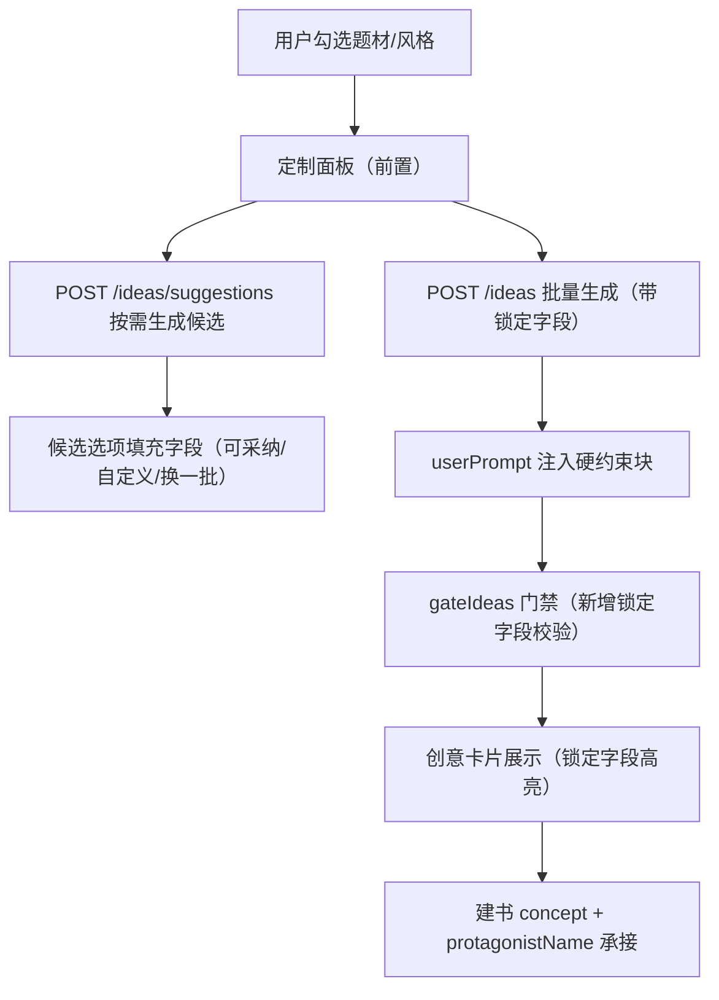

# 灵感生成器「填入信息」定制功能

Feature Name: ideas-fillable-info
Updated: 2026-10-15

## Description

在灵感生成器（`web/src/views/InspirationGenerator.vue` → `POST /ideas`）中，题材/风格选择与批量生成之间插入一个「定制主角与剧情」面板。AI 按需为每个字段生成候选选项，用户可采纳或自定义，值作为硬约束注入批量创意提示词。

核心目标：
1. 主角信息（姓名/身份/性格/金手指）不再由模型自由发挥导致错乱。
2. 剧情走向（主线/核心冲突/开局形态）按用户预期，同时保留创意间差异化。
3. 不破坏现有去重、门禁、断线续跑机制。

## Architecture



## Components and Interfaces

### 前端 `web/src/views/InspirationGenerator.vue`

新增状态：
- `lockedFields = reactive({ protagonistName: '', protagonistIdentity: '', protagonistPersonality: '', goldenFinger: '', plotDirection: '', coreConflict: '', openingForm: '' })`
- `suggestions = reactive({})` 各字段的候选数组
- `suggestLoading = ref(false)`

新增交互：
- 面板位于「期望风格基调」之后、「批量生成」按钮之前。
- 「AI 帮我生成建议」按钮 → `POST /ideas/suggestions`。
- 每个字段显示 AI 候选 tag（点击采纳）+ 输入框（可自定义覆盖）。
- 生成按钮禁用条件不变，但提交 `/ideas` 时附带 `lockedFields`。

模板结构示意：
```html
<el-form-item label="定制主角与剧情（可选）">
  <div class="locked-panel">
    <div class="locked-field" v-for="f in lockFieldDefs">
      <div class="lf-label">{{ f.label }}</div>
      <div class="lf-suggest" v-if="suggestions[f.key]?.length">
        <span v-for="s in suggestions[f.key]" class="suggest-tag"
              @click="applySuggestion(f.key, s)">{{ s }}</span>
      </div>
      <el-input v-model="lockedFields[f.key]" :placeholder="f.placeholder" />
    </div>
    <el-button :loading="suggestLoading" @click="fetchSuggestions">
      {{ suggestionsReady ? '换一批建议' : 'AI 帮我生成建议' }}
    </el-button>
  </div>
</el-form-item>
```

### 后端新增路由 `POST /ideas/suggestions`

- 请求体：`{ genres, stylePresets, styleIds, channel, marketList }`（与 /ideas 同源，无需 count/seed）。
- 响应：`{ suggestions: { protagonistName: [...], protagonistIdentity: [...], protagonistPersonality: [...], goldenFinger: [...], plotDirection: [...], coreConflict: [...], openingForm: [...] } }`
- 实现：新增 `IDEAS_SUGGESTIONS_SYSTEM` 提示词（prompts.js），单次调用生成全部字段候选；复用 `extractJson`/`extractArray` 解析；失败返回 `{ suggestions: {} }` 不阻塞。
- 字段候选数量：每字段 3-4 个，按题材（幻想/现实/系统/穿越/青春等分轨，复用现有 `GF_POOL`/`ID_POOL`/`CONFLICT_GENERAL`/`OPENING_DRIVES` 的判定逻辑提供示例）。

### 后端修改 `POST /ideas`

- 请求体新增 `lockedFields`（对象，仅含非空值）。
- 组装 `userPrompt` 时注入 `lockedBlock`：

```text
【主角与剧情硬约束（用户已锁定，必须严格采用）】
- 主角姓名必须为：{protagonistName}（所有创意的主角都叫这个名字，严禁改名）
- 主角身份必须为：{protagonistIdentity}
- 主角性格必须为：{protagonistPersonality}
- 金手指/最大优势必须为：{goldenFinger}（严禁替换为其他设定，可展开细节但根基不变）
- 主线剧情走向必须贴合：{plotDirection}
- 核心冲突必须围绕：{coreConflict}
- 开局形态必须采用：{openingForm}
- 各创意仍须在未锁定维度保持彼此不同。
```

- `axisBlock` 中若有候选槽位与锁定值冲突，锁定值优先。

### `gateIdeas` 新增锁定校验

- 若 `lockedFields.protagonistName` 存在：每条创意 `protagonist.name` 必须包含锁定名（全名匹配或主角名 = 锁定名），否则剔除。
- 若 `lockedFields.goldenFinger` 存在：每条创意 `protagonist.golden_finger` 必须与锁定值语义一致（包含锁定值核心词），否则剔除并提示。
- 若锁定字段命中剔除，触发既有数量补齐轮（复用 `ensureStoryEngine` 前的补齐逻辑）。

### 数据流承接（建书）

- `InspirationGenerator.vue` 的 `buildNovelFromIdea`：把 `lockedFields.protagonistName` 并入 `protagonistName`（若卡片主角名不同则以锁定名为准）；把 `lockedFields.plotDirection/coreConflict/openingForm` 并入 `formatIdeaAsConcept` 输出（新增锁定字段行）。
- `formatIdeaAsConcept`（web/src/utils/format.js）新增：若 idea 带 `locked` 字段，追加「定制约束」行。

## Data Models

无新表。请求体新增字段：

```jsonc
// POST /ideas 增量
{
  "lockedFields": {
    "protagonistName": "林晚",
    "protagonistIdentity": "外门杂役弟子",
    "protagonistPersonality": "谨慎盘算",
    "goldenFinger": "残缺功法补全",
    "plotDirection": "宗门大比登顶之路",
    "coreConflict": "守约与背约",
    "openingForm": "当场利害"
  }
}
```

`suggestions` 响应结构见上。`idea_runs` 落盘对象保持不变（断线续跑兼容）。

## Correctness Properties

1. **硬约束优先**：锁定字段在 prompt 中的优先级高于差异化轴与候选槽位；当用户锁定金手指时，候选金手指槽位被抑制。
2. **差异化保底**：即使锁定多个字段，剩余维度（世界观切入/反派动机/副线/卖点）仍须批内互异，`axisBlock` 的「至少 3 项不同」在未锁定维度继续生效。
3. **门禁兜底**：`gateIdeas` 对锁定字段做机器校验，prompt 层失守时剔除并补齐，杜绝「锁了金手指却产出别的」。
4. **兼容性**：`lockedFields` 全空时，请求体/提示词与旧版完全一致，旧流程零回归。
5. **候选独立性**：`/ideas/suggestions` 仅读取输入生成建议，不写库、不依赖 idea_runs、不改变现有去重状态。

## Error Handling

| 场景 | 处理 |
|------|------|
| 建议生成失败/解析失败 | 返回 `{ suggestions: {} }`，前端保留已填字段，提示可重试；批量生成不受影响 |
| 建议生成中重复点击 | 前端 `suggestLoading` 防抖禁用 |
| 锁定字段与门禁冲突剔除全部 | 复用现有数量补齐轮带反馈重生；提示用户可放宽部分锁定 |
| 网络断线（建议请求） | 普通请求失败提示，不影响断线续跑链路 |
| 用户锁定金手指后候选仍含它 | 候选是参考，锁定后轴抑制不注入该槽位 |

## Test Strategy

1. `node --check server/src/routes.js server/src/prompts.js`
2. 新增 `server/test/ideas_suggestions.test.js`：
   - mock LLM 返回结构化 suggestions JSON → 断言 7 字段各 3-4 个候选
   - 解析失败 → `{ suggestions: {} }`
3. `server/test/ideas_locked.test.js`（或扩展 test_ideas_engine.mjs）：
   - 构造锁定 `lockedFields`，mock LLM 输出 → 断言 `userPrompt` 含硬约束块
   - 构造一条金手指偏离锁定值的创意 → `gateIdeas` 剔除
   - 锁定主角名 → 偏离创意被剔除
   - lockedFields 全空 → 输出与旧版一致（回归）
4. 前端 `npx vite build` 通过。
5. 手工验证：页面生成建议 → 采纳/自定义 → 批量生成 → 卡片展示锁定字段 → 建书后 concept 含锁定走向。

## References

[^1]: (server/src/routes.js#L1904) - `POST /ideas` 路由
[^2]: (server/src/routes.js#L2273) - `gateIdeas` 门禁
[^3]: (server/src/prompts.js#L3009) - `IDEAS_SYSTEM`
[^4]: (web/src/views/InspirationGenerator.vue) - 灵感生成器页面
[^5]: (web/src/utils/format.js#L256) - `formatIdeaAsConcept`
